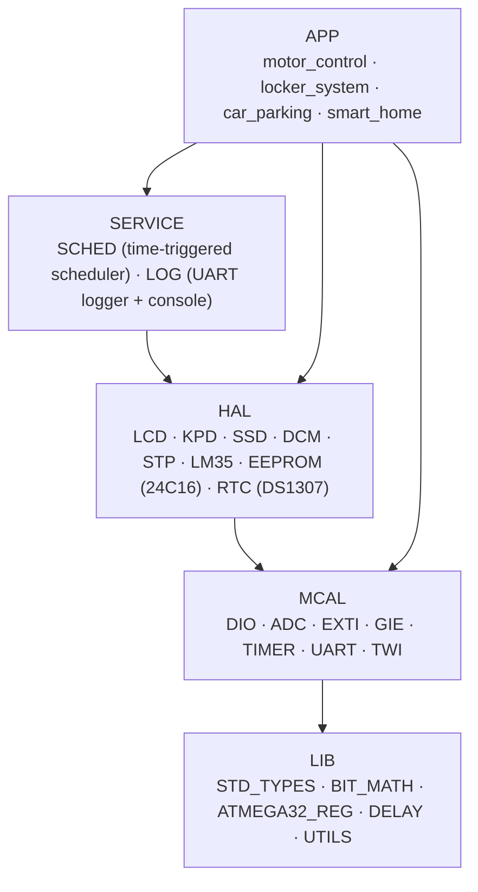

# ATmega32 Layered Drivers

Configurable driver stack for the **AVR ATmega32**, written in C with a strict
layered architecture (MCAL → HAL → Service → Application), consistent naming
conventions and MISRA-C-oriented coding rules. Four applications are built on
top of the same drivers:

| Application | What it does | Main drivers |
|---|---|---|
| `motor_control` | Potentiometer sets DC motor speed (PWM); buttons on external interrupts reverse the DC motor and the stepper; LCD shows status | DIO, ADC, Timer0 PWM, EXTI, LCD, DC motor, stepper, scheduler |
| `locker_system` | 4-digit PIN lock with keypad; PIN and failed-attempt counter in external EEPROM; 3 wrong PINs → 30 s lockout; time-stamped UART log | Keypad, LCD, I2C, 24C16 EEPROM, DS1307 RTC, UART, logger |
| `car_parking` | Entry/exit IR sensors on interrupts, gates, free-slot count on seven-segment and LCD; occupancy survives power loss; UART log | EXTI, SSD, LCD, I2C, EEPROM, RTC, UART, logger |
| `smart_home` | LM35 temperature, proportional fan cooling with hysteresis, latched fire alarm (flame sensor or over-temperature) with sprinkler relay and buzzer | ADC, LM35, Timer0 PWM, EXTI, LCD, scheduler |

The drivers also build and run on a PC: a register-mapping layer lets
**261 unit-test checks** verify the exact register values every driver writes.

---

## Architecture



A layer only calls the layers below it. Registers are touched **only** in
MCAL; HAL drivers reach the hardware exclusively through MCAL APIs.

### Folder layout

```
LIB/                 types, bit macros, register map, delays, string utils
MCAL/<MODULE>/       MODULE_interface.h  public API
                     MODULE_private.h    internal constants
                     MODULE_program.c    implementation
HAL/<MODULE>/        same structure
SERVICE/<MODULE>/    same structure
CONFIG/default/      default MODULE_config.h for every module
APP/<app>/main.c     application
APP/<app>/config/    config files this app overrides
APP/<app>/app.mk     modules linked into this app
test/                host unit tests
```

### Configuration

Every module is configured at build time through its `MODULE_config.h`.
The include path puts `APP/<app>/config` **before** `CONFIG/default`, so an
application overrides only the files it needs and inherits the rest. Example,
`smart_home` switches the ADC to the internal 2.56 V reference (0.25 °C LM35
resolution) by providing its own `ADC_config.h`, while `motor_control` keeps
the default AVCC reference for its potentiometer.

`DIO_config.h` sets every pin's initial direction and level in one readable
table:

```c
/*                                      P7 P6 P5 P4 P3 P2 P1 P0 */
#define DIO_PORTD_DIRECTION   CONC_BIT( O, O, O, O, I, I, I, I )
#define DIO_PORTD_INIT_VALUE  CONC_BIT( L, L, L, L, H, H, L, L )
```

---

## Coding rules

**Naming**

| Element | Pattern | Example |
|---|---|---|
| Public function | `MODULE_<ret><Name>` | `DIO_enuSetPinValue`, `GIE_voidEnable`, `SCHED_u32GetTicks` |
| Parameter | `Copy_<type><Name>` | `Copy_u8Port`, `Copy_pu16Result`, `Copy_pfCallback` |
| Local | `Local_<type><Name>` | `Local_enuErrorState` |
| Module global | `MODULE_<type><Name>` (always `static`) | `ADC_u8State`, `KPD_au8KeyMap` |
| Type prefixes | `u8 u16 u32 s32`, `p` pointer, `a` array, `pf` function pointer, `enu` enum, `str` struct, `c` char | |

**MISRA-C:2012-oriented rules applied** (style guide, not a certified
compliance claim):

- Fixed-width types only; every literal has a `U`/`UL` suffix; explicit casts
  on every narrowing conversion.
- Every public API returns `ES_t` and validates its arguments
  (`ES_NULL_POINTER`, `ES_OUT_OF_RANGE`) before touching hardware.
- One exit point per function; every `if … else if` chain ends in `else`;
  every `switch` has a `default`; all bodies in braces.
- No dynamic memory, no recursion, no standard library in drivers.
- All hardware polling loops are **bounded** and return `ES_TIMEOUT`, so a
  missing or broken device can never hang the system.
- Shared ISR/main-loop data is `volatile`; multi-byte reads and
  read-modify-writes are wrapped in `GIE_u8EnterCritical()` /
  `GIE_voidRestore()`.
- Files and modules have no circular dependencies; private headers are never
  included outside their module.

The code builds warning-free with `-Wall -Wextra -Wpedantic -Wshadow
-Wstrict-prototypes -Wmissing-prototypes -Wcast-qual -Wundef
-Wswitch-default -Werror`, on GCC and Clang, also clean under `-Wconversion`,
clang-tidy (`bugprone-*`, `clang-analyzer-*`) and AddressSanitizer/UBSan.

---

## Design decisions worth knowing

- **Time-triggered cooperative scheduler** (`SCHED`). Timer2 in CTC mode gives
  a 1 ms tick. The ISR only marks tasks as ready; the main loop runs them.
  If a task overruns, missed periods are **dropped, not replayed**, so a
  stepper never receives a burst of catch-up steps.
- **Interrupts stay short.** EXTI callbacks only set flags (with a time-based
  bounce lockout); real work such as reversing a motor, which needs a dead
  time, happens in a task.
- **Non-blocking keypad.** `KPD_enuGetPressedKey()` reports a key once on the
  debounced press edge and never blocks waiting for release.
- **PWM glitch fix.** Fast PWM still emits a one-tick pulse at `OCR0 = 0`, so
  a 0 % duty disconnects OC0 and holds the pin low.
- **H-bridge dead time.** The DC motor coasts briefly before reversing.
- **Security.** The locker compares PINs in constant time and stores the
  failed-attempt counter in EEPROM, so power-cycling during a lockout does not
  reset it.
- **Data integrity.** Parking occupancy is stored with a bit-inverted copy;
  a blank or corrupted record is detected at boot.
- **Fail-safe smart home.** A sensor fault runs the fan at 100 %; during a
  fire the fan is switched **off** (no fresh oxygen) and the alarm is latched
  until reset with safe conditions. A flame present at power-up (no edge) is
  caught by a level check.
- **JTAG.** The factory-programmed JTAGEN fuse takes PC2..PC5 away from the
  port. `DIO_enuInit()` disables JTAG with the timed double write to `JTD`.

---

## Hardware

ATmega32 at **8 MHz** (`F_CPU`), 5 V. Common to all apps:

| Function | Pins |
|---|---|
| LCD 16x2 (4-bit, RW → GND) | RS PB0, EN PB1, D4..D7 PB4..PB7 |
| UART 9600 8N1 | RXD PD0, TXD PD1 |
| I2C (4.7 kΩ pull-ups) | SCL PC0, SDA PC1 |
| PWM (Timer0 OC0) | PB3 |

### motor_control

| Part | Pins |
|---|---|
| Potentiometer wiper | PA0 (ADC0) |
| L293D: EN1 / IN1 / IN2 | PB3 / PD4 / PD5 |
| ULN2003 + 28BYJ-48: IN1..IN4 | PC2..PC5 |
| Button → GND, reverse DC motor | PD2 (INT0) |
| Button → GND, reverse stepper | PD3 (INT1) |

### locker_system

| Part | Pins |
|---|---|
| 4x4 keypad rows / columns | PC2..PC5 / PD4..PD7 |
| 24C16 EEPROM, DS1307 RTC | I2C bus |
| Lock relay, buzzer, green LED, red LED | PA0, PA1, PA2, PA3 |

Keys: digits enter the PIN, `C` clears, `=` relocks, `*` changes the PIN
while unlocked. First boot asks for a new PIN twice.

### car_parking

| Part | Pins |
|---|---|
| Entry / exit IR sensor (active low) | PD2 (INT0) / PD3 (INT1) |
| Seven-segment, common cathode, a..g | PA1..PA7 |
| Entry gate, exit gate, FULL LED, buzzer | PD4, PD5, PD6, PD7 |
| 24C16 EEPROM, DS1307 RTC | I2C bus |

### smart_home

| Part | Pins |
|---|---|
| LM35 output (100 nF from AREF to GND) | PA1 (ADC1) |
| Fan via L293D: EN1 / IN1 / IN2 | PB3 / PD4 / PD5 |
| Flame sensor DO (active low) | PD2 (INT0) |
| Alarm reset button → GND | PD3 (INT1) |
| Buzzer, alarm LED, pump relay, OK LED | PC2, PC3, PC4, PC5 |

### Setting the RTC

`locker_system` and `car_parking` accept a time-set command on the serial
console (9600 8N1): send `TYYMMDDhhmmss` followed by Enter, for example
`T261110230600` for 2026-11-10 23:06:00. Log lines look like:

```
[2026-11-10 23:06:02] Car in, free slots: 8
```

---

## Building

Requirements: `avr-gcc`, `avr-libc`, `avrdude`, `make`
(Ubuntu: `sudo apt install gcc-avr avr-libc avrdude make`).

```bash
make                         # builds motor_control -> build/motor_control/motor_control.hex
make APP=smart_home          # any of the four apps
make all-apps
make flash APP=car_parking   # USBasp; override with PROGRAMMER=...
```

Fuses for the 8 MHz internal RC oscillator (factory default is 1 MHz):

```bash
avrdude -c usbasp -p m32 -U lfuse:w:0xE4:m -U hfuse:w:0xD9:m
```

`hfuse 0xD9` also disables JTAG in hardware (the code disables it at run time
as well).

The `.hex` files can be loaded directly into **Proteus** or **SimulIDE** for
simulation.

## Testing on a PC

```bash
make test          # 261 checks over every driver
make host-check    # compiles and links all four apps with -Werror
```

With `-DHOST_TEST`, `LIB/ATMEGA32_REG.h` maps each register onto a RAM array.
A test preloads "hardware" state (for example sets `ADIF` and `ADCL/ADCH`),
calls the driver, and checks the registers it wrote. ISRs are ordinary
functions on the host, so tests call them to simulate interrupts, for example
1 ms scheduler ticks.

```
MCAL
  test_adc                        ok
  test_timer0_pwm                 ok
  ...
SERVICE
  test_scheduler                  ok
  test_log                        ok

261 checks, 0 failed
```
